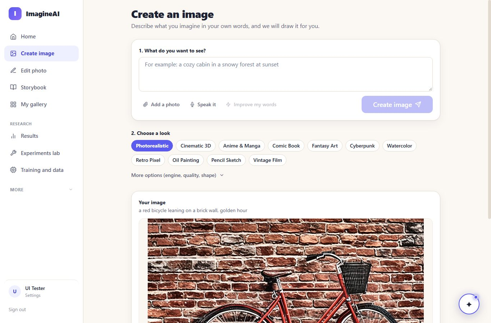
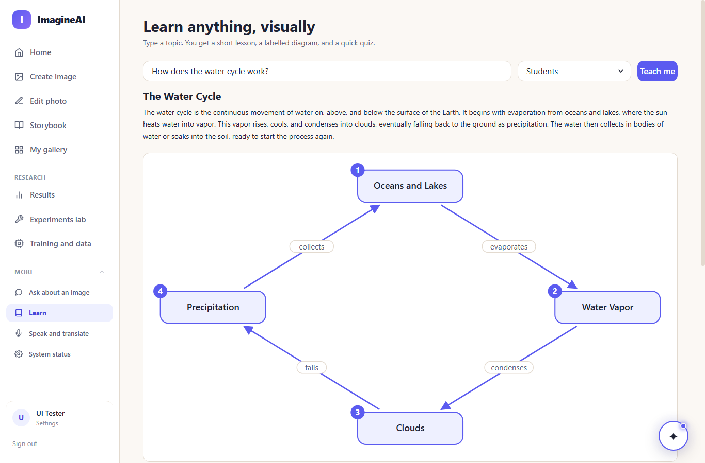
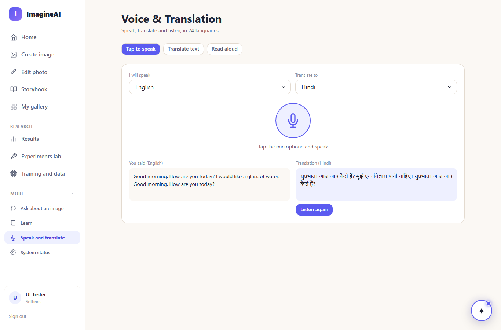
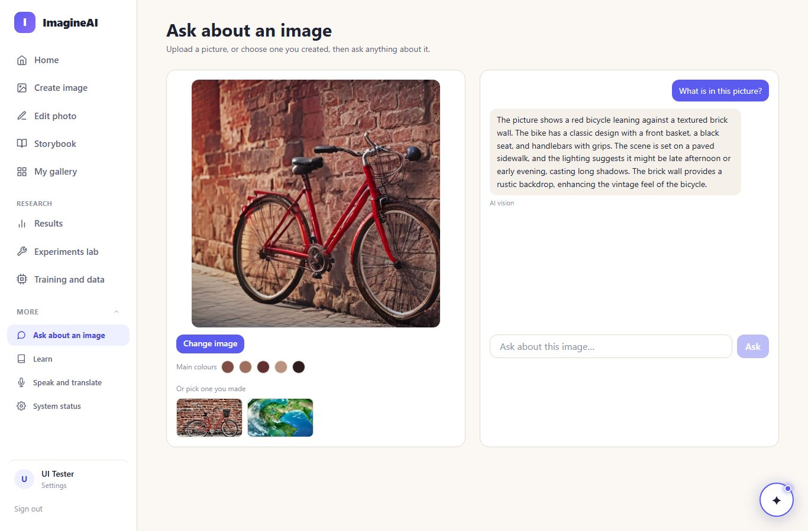
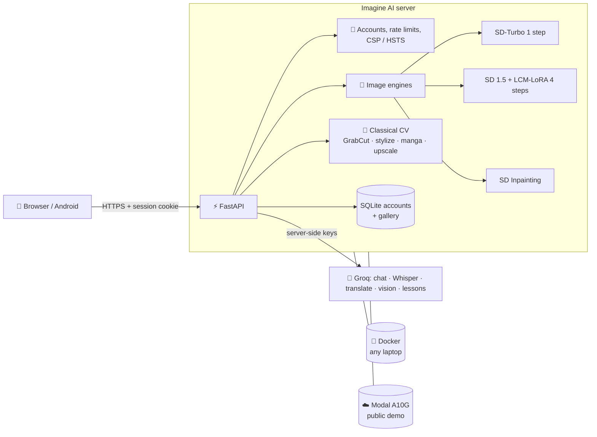

<div align="center">

# 🎨 Imagine AI

### Text-to-image that fits in your pocket and answers in a blink.

**43× faster than the Stable Diffusion 1.5 baseline · 39–56 % less GPU memory · runs on a laptop, a phone-class budget, or one `docker` command**


**[🚀 Live demo](https://dilipr1813--imagineai.us-east.modal.run)** · **[🐳 Run it yourself](#-run-it-on-any-laptop-one-command)** · **[📊 Results](#-the-numbers-all-measured)** · **[🧠 How it works](#-how-it-works)**

<sub>The demo sleeps when nobody is using it, so the very first visit can take about a minute while the GPU wakes up. After that, pictures take about a second.</sub>

</div>

---

## ✨ What is this?

Imagine AI is a complete, working **resource-efficient text-to-image studio** (hackathon problem statement **P3**): one website, one API and an Android app that turn words into pictures **fast, on small hardware**, plus the tools people actually want around them: photo editing, comic storybooks, lessons with diagrams, voice translation and "ask about this picture".

We did not just build the app. We **measured everything** on a real GPU, kept the negative results, and wired the winners into the product.

<table>
<tr>
<td width="50%"><br/><sub><b>Create</b>: one sentence in, a picture out. 11 looks, 3 quality modes.</sub></td>
<td width="50%"><br/><sub><b>Learn</b>: type any topic, get a lesson, a labelled diagram and a quiz.</sub></td>
</tr>
<tr>
<td width="50%"><br/><sub><b>Speak &amp; translate</b>: tap the mic, talk, hear it in another language. 24 languages.</sub></td>
<td width="50%"><br/><sub><b>Ask about an image</b>: upload a picture or pick one you made, then ask anything.</sub></td>
</tr>
</table>

---

## 📊 The numbers (all measured)

Everything below comes from `evaluation/results/` and was measured on an **NVIDIA RTX 5050 Laptop GPU (8 GB)**: 300 held-out COCO prompts, 512×512, batch 1, same seeds, warm-up discarded. The baseline **B0 is Stable Diffusion 1.5, fp32, 30 steps**.

| Variant | Median latency | Speed-up | Peak VRAM | Model size | FID ↓ | CLIP ↑ |
|---|---:|---:|---:|---:|---:|---:|
| **B0** SD 1.5 fp32, 30 steps *(baseline)* | 10 545 ms | 1× | 5 066 MB | 4 068 MB | 112.5 | 0.316 |
| B1 + fp16 | 4 303 ms | 2.5× | 2 676 MB | 2 034 MB | 112.6 | 0.316 |
| O4 + public LCM-LoRA, 4 steps | 451 ms | 23× | 2 816 MB | 2 163 MB | 121.2 | 0.303 |
| O4T + tiny VAE decoder (TAESD) | **340 ms** | 31× | **2 207 MB** (−56 %) | 2 008 MB | 122.0 | 0.303 |
| **T1 SD-Turbo, 1 step** ⭐ | **247 ms** | **43×** | 3 098 MB (−39 %) | 2 461 MB | **117.1** | **0.321** |

> **The winner is SD-Turbo in one step:** 43× faster than the baseline, with a **higher CLIP score** (it follows the prompt better) and the best FID of every fast variant. That is why it is the website's default.

```text
Latency per picture (shorter is better)
B0   ████████████████████████████████████████████████  10 545 ms
B1   ████████████████████                               4 303 ms
O4   ██                                                   451 ms
T1   █                                                    247 ms   ← default
```

### ☁️ On a cloud A10G (Modal)

| Setup | Latency | FID | Notes |
|---|---:|---:|---|
| SD-Turbo, 1 step | 125 ms | 117.0 | |
| SD-Turbo + TAESD, 1 step | **56 ms** | 116.3 | smaller and 2.2× faster again |
| SD-Turbo + TAESD, 2 steps | 89 ms | 118.7 | |

### 🎯 Best-of-N: make it right more often

Generate N candidates with SD-Turbo (still milliseconds each), let an **independent detector (DETR + colour check) pick the best**, and have a **different model (OWL-ViT) judge** the result, so we never grade our own homework. Correct-prompt rate on 100 compositional prompts (counting, colours, positions, two objects):

| N = 1 | N = 2 | N = 4 | N = 8 |
|:---:|:---:|:---:|:---:|
| 62 % | 63 % | 70 % | **75 %** |

### 🧪 Honest negative results (we kept them)

Good research reports what *didn't* work. These are in the Results page of the app too.

- **Our own LCM-LoRA ties the public one, it does not beat it.** FID 120.4 vs 121.2 is well inside the noise (KID 0.010 ± 0.003 for both), and ours is ~8 % slower. So it is available on the site as "ours" but is **not approved as better**. Longer training (500 → 2000 steps) drifted slightly *worse*.
- **A scale bug cost us a run.** Our first distillation used LoRA alpha 64 while the public adapter uses 8, which made it 8× too strong (FID 253, garbage). We found it, wrote it up in [`evaluation/reports/distillation_scale_bug.md`](evaluation/reports/distillation_scale_bug.md), and added a guard so the trainer now refuses mismatched alpha.
- **int8 weight-only quantisation was slower** (495 ms vs 451 ms) even though it saved memory, so we documented it and left it off.
- **Classical CV post-processing barely moves FID/CLIP**, because generated images are already clean.

---

## 🧰 What you can do on the site

| | Feature | What it really does |
|---|---|---|
| 🖼️ | **Create** | Prompt → picture with **11 styles** (watercolor, anime, pixel…) finished by real computer-vision filters, not just prompt tricks. 1-step "Quick", 4-step "Balanced". |
| ✂️ | **Edit photo** | **Real inpainting.** Draw around something (or tap *Smart select*, a GrabCut segmentation) and describe the change. Everything outside your mask stays **bit-for-bit identical**. |
| 📖 | **Storybook & manga** | An LLM writes a comic script (shots, dialogue, sound effects), each panel is drawn, then **composed into a real manga/comic page** and exported as PDF. |
| 🎓 | **Learn** | Any topic → lesson, key points, **labelled SVG diagram** (flow, cycle or parts), quiz, optional illustration. |
| 🎙️ | **Speak & translate** | Tap to speak → Whisper transcribes → translates → **speaks it back**. 24 languages, plus text translate and read-aloud. |
| 👁️ | **Ask about an image** | Upload or pick a creation and ask questions. Answers come from a multimodal model in ~1 s; measured facts (colours, sharpness) are always shown. |
| 💬 | **Assistant** | Floating chat that remembers the conversation. |
| 🗂️ | **Gallery** | Everything you make, saved to your account. |
| 📈 | **Results & Lab** | The benchmark above, live from the result files, plus an interactive stress lab. |
| 🛡️ | **Admin** | System status and team dashboard. |

📱 There is also a native **Android app** (`android/`) that talks to the same API.

---

## 🧠 How it works



**Efficiency stack, in the order each trick was measured:** fp16 → LCM-LoRA (4 steps instead of 30) → SD-Turbo (1 step) → TAESD tiny decoder → optional best-of-N with an independent verifier. On CPU-only machines the same code falls back to fp32 automatically.

**Safety & hardening:** every API route needs a signed-in user, passwords are scrypt-hashed, sign-in is brute-force limited, per-user rate limits protect the GPU and the paid APIs, uploads are size- and type-checked, the page ships a strict CSP + HSTS, and **secrets never reach the browser**.

---

## 🐳 Run it on any laptop (one command)

You only need **Docker**. No Python, no CUDA, no model hunting.

```bash
git clone https://github.com/dilip-ravichandra/imagine.git
cd imagine
# Windows:   double-click  docker\start.bat
# Mac/Linux:
./docker/start.sh
```

Open **http://localhost:8000**, create an account, make pictures.

- First start builds the image (~10 min). Models download once on first use and are cached in a Docker volume.
- Add a free [Groq key](https://console.groq.com/keys) to `docker/.env` to switch on the assistant, Learn, translate, voice and ask-about-image. Without it, image creation and editing still work.
- Have an NVIDIA GPU? `docker compose -f docker/docker-compose.yml -f docker/docker-compose.gpu.yml up -d --build`.
- Details, speeds and troubleshooting: **[`docker/README.md`](docker/README.md)**.

| Machine | Default model, 1 step | Balanced, 4 steps |
|---|---|---|
| NVIDIA GPU | ~0.3 s | ~0.5 s |
| CPU only | ~10–40 s | ~1–3 min |

<details>
<summary><b>🛠️ Run without Docker (developers)</b></summary>

```bash
python -m venv .venv && source .venv/bin/activate        # Windows: .venv\Scripts\activate
pip install -r requirements.txt -r requirements-ml.txt peft
cd frontend && npm ci && npx vite build && cd ..
IMAGINEAI_HOSTED_VARIANTS=1 IMAGINEAI_ALLOW_DOWNLOAD=1 uvicorn backend.app.main:app --port 8000
# frontend dev server with hot reload: cd frontend && npm run dev
python -m pytest -q                                      # 755 tests
```
Install the CUDA build of PyTorch first if you have an NVIDIA GPU.
</details>

<details>
<summary><b>☁️ Deploy your own copy on Modal</b></summary>

`modal_deploy.py` ships an A10G web app with a persistent volume for accounts and pictures, an admin bootstrap and HTTPS cookies. See [`MODAL_DEPLOY_GUIDE.md`](MODAL_DEPLOY_GUIDE.md), and **set a $0 spend limit in the Modal dashboard first**.

```bash
python -m modal deploy modal_deploy.py
```
</details>

---

## 🗺️ Project map

```text
backend/            FastAPI app: auth, image engines, creative + feature routes, security
frontend/           React + Chakra UI website (17 pages)
computer_vision/    Classical CV: smart select, stylize, manga composer, upscale, analyse
ai_engine/          Training (LCM-LoRA distillation), optimisation, adaptive controller
evaluation/         Benchmarks, results (FID/KID/CLIP), reports, QA scripts
android/            Native Android client
docker/             One-click Docker bundle for any laptop
tests/              755 automated tests
modal_*.py          Cloud deployment, cloud evaluation and cloud training jobs
docs/               Design documents, phase reports, previous README
```

## ✅ Quality

- **755 automated tests** (`python -m pytest -q`).
- **24 real-browser checks** (`evaluation/scripts/_cdp_qa.py`) drive the actual site in Edge: sign-up and sign-out, protected pages, the Learn diagram, image creation with a pixel check that it is not blank, **tap-to-speak with a real spoken clip**, translation, ask-about-image, chat memory and settings. They pass against the local server, the Docker container and the live deployment.
- Every figure in this README is read from files in `evaluation/results/`, not typed in by hand.

## 🙏 Built on the shoulders of

[Stable Diffusion 1.5](https://huggingface.co/stable-diffusion-v1-5/stable-diffusion-v1-5) and [SD-Turbo](https://huggingface.co/stabilityai/sd-turbo) (Stability AI) · [LCM-LoRA](https://huggingface.co/latent-consistency/lcm-lora-sdv1-5) · [TAESD](https://github.com/madebyollin/taesd) · [Diffusers](https://github.com/huggingface/diffusers) · [OWL-ViT](https://huggingface.co/google/owlvit-base-patch32) and [DETR](https://huggingface.co/facebook/detr-resnet-50) · [COCO](https://cocodataset.org) · Whisper and Qwen via [Groq](https://groq.com) · [Modal](https://modal.com) · FastAPI, React, Chakra UI and OpenCV.

Please respect each model's own licence before reusing the weights.

---

<div align="center">

**Made with ☕, a lot of GPU hours, and a refusal to hide the bad results.**

</div>
