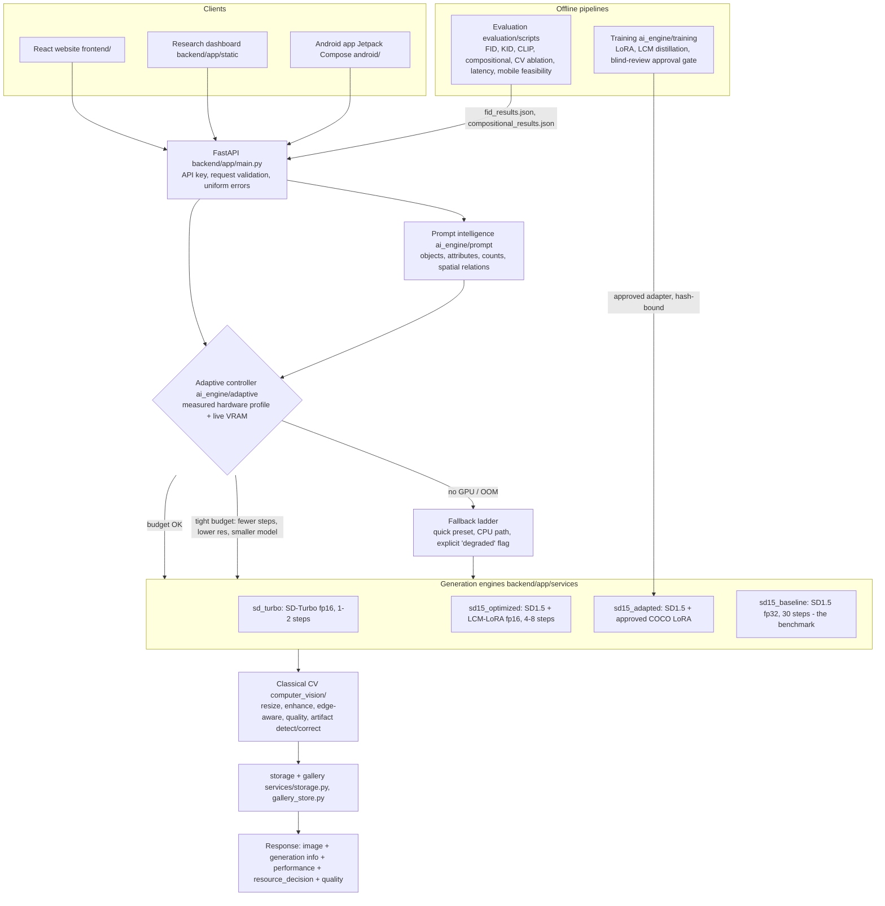

# Architecture (as implemented in this repo)

**Deployment mode: hybrid edge-server.** Lightweight clients (React website, research dashboard, Android app) send a prompt
to a GPU-backed FastAPI server. Nothing diffusion-related runs on the phone; the on-device question is answered
analytically in `evaluation/reports/mobile_feasibility.md` (estimates, not a phone benchmark).

## Endpoints (API v1)

| Endpoint | Purpose |
|---|---|
| `GET /health`, `/api/v1/capabilities`, `/api/v1/model`, `/api/v1/models` | liveness, limits, active model, model catalogue |
| `POST /api/v1/generate` | text to image with the adaptive controller (production path) |
| `POST /api/v1/generate/multimodel` | explicit model choice: `sd_turbo`, `sd15_optimized`, `sd15_adapted`, `sd15_baseline` |
| `POST /api/v1/generate/img2img`, `/inpaint` | edit paths used by the studio pages |
| `POST /api/v1/prompt/analysis`, `/prompt/enhance` | structured prompt analysis, LLM prompt enhancement |
| `POST /api/v1/adaptive/stress-generate` | Stress Lab: generation under a simulated latency/VRAM budget |
| `GET /api/v1/metrics/benchmark`, `/metrics/summary` | **measured** FID/KID/CLIP/latency/VRAM/size table (read from `evaluation/results/fid/`) |
| `GET /api/v1/training/runs` | **real** adapter training records and dataset manifests |
| `GET/POST/DELETE /api/v1/gallery` | stored generations |

## Order of operations in `generate()`
prompt analysis → adaptive controller (steps, resolution, model, fallback) → engine → optional CV stage (assess/correct) →
save once → response containing `resource_decision` (why this configuration was chosen).

## Opt-in switches
`PRECISION, ATTENTION_SLICING, VAE_SLICING, OFFLOAD, WEIGHTS_VARIANT` (inference optimisation); `CV_MODE=off|assess|correct`;
`ADAPTIVE_PROFILE/POLICY/ALLOW_SYNTHETIC/DECISION_LOG`; `ADAPTER_PATH/ADAPTER_WEIGHT`; `MODEL_REVISION`, `PRELOAD_MODEL`;
`IMAGINEAI_HOSTED_VARIANTS=1` serves the React site at `/`.

## What the diagram deliberately does not claim
No on-device inference, no cloud autoscaling. The hosted demo is a single GPU (laptop or a Hugging Face ZeroGPU Space).
