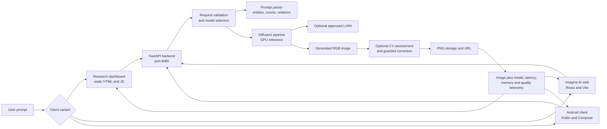

# Imagine AI: Methodology, Computer Vision, and System Architecture

## Presentation scope

Imagine AI has three user-facing application variants in this repository: a research dashboard, a React web application, and an Android client. They share the same laptop-hosted FastAPI service and GPU model runtime; they are not three independent AI models. The controlled model study separately compares three Stable Diffusion 1.5 configurations: an unmodified baseline, the project-trained LoRA adaptation, and an accelerated LCM-LoRA configuration. This document covers both sets of three so the presentation does not mix up app interfaces with model variants.

The project is best described as **resource-aware text-to-image generation with a classical computer-vision quality-assessment and correction stage**. The generative model synthesizes the image. The CV stage measures selected low-level image properties and may apply conservative pixel-level corrections. It does not guarantee semantic correctness.

## 1. Problem and objective

High-quality diffusion models can take many denoising steps and require substantial GPU memory. That makes image generation slow or impractical on a phone. Imagine AI addresses this through a hybrid architecture: a lightweight web or mobile client sends a prompt to a GPU-enabled laptop backend, which runs inference and returns an image plus generation telemetry.

The project has four related objectives:

1. Compare model configurations under controlled prompts and seeds.
2. Adapt Stable Diffusion 1.5 to the project’s caption distribution with a small LoRA adapter.
3. reduce inference cost through precision and step-count choices.
4. Apply classical CV measurements and guarded corrections after generation, while keeping failures or unsupported artifacts visible.

## 2. Three model configurations

These are experimental configurations, not separate application clients.

| Configuration | Model path | Purpose | Current evidence and limits |
|---|---|---|---|
| **A. SD 1.5 baseline** | Stable Diffusion 1.5 without the project LoRA; standard 30-step reference in the model comparison UI | Reference quality and resource use | Establishes the comparison point. Report latency and memory only from the matching recorded benchmark; do not reuse estimates from old UI copy as measured results. |
| **B. Project-adapted SD 1.5** | Same SD 1.5 base revision with the project COCO LoRA; inference weight 0.25 and 30 steps in the adapted-model path | Test whether a small task adaptation improves prompt-to-image results without replacing the base model | Adapter training used 10,000 train and 1,000 validation captions, balanced by caption length; rank 4; 2,500 optimizer steps; 512-pixel training images. On 59 valid blind validation pairs at scale 0.25, it was better-or-tied on 51/59 (86.4%). This is a limited paired review, not proof of general superiority. |
| **C. Accelerated SD 1.5** | SD 1.5 with the public Latent Consistency Model LoRA, FP16, nominally 8 steps | Demonstrate a speed-oriented sampling configuration while retaining the SD 1.5 family | This is a separate acceleration adapter from the project-trained COCO LoRA. Treat its speed and quality as a hypothesis until results from the same protocol are reported. |

The app also exposes **SD-Turbo**, a separately distilled, very-low-step model. It is an additional speed reference, not one of the three controlled SD 1.5 configurations above. Do not describe SD-Turbo as the project’s LoRA model.

### LoRA adaptation method

LoRA (Low-Rank Adaptation) fine-tunes a small number of low-rank parameter matrices attached to selected model layers instead of updating all Stable Diffusion weights. This reduces trainable parameter count and produces a compact adapter that is loaded on top of a fixed base checkpoint. The base revision, adapter file hash, approval record, and runtime weight are checked by the repository’s adapter gate.

The project dataset was built from COCO image-caption pairs. Captions were balanced between short and longer examples, evaluation prompts were excluded from training selection, and a manifest was written to support reproducibility. During inference, the adapter weight controls how strongly the learned update influences the base model. A lower weight can reduce over-specialization but must be validated empirically; it is not automatically better.

### Comparison protocol

For a fair comparison, keep the prompt, random seed, resolution, and any other applicable inference settings the same between the base and adapted outputs. Review outputs as blind pairs so the reviewer does not know which side is adapted. Record better / tie / worse, generation failures, and visible artifacts separately. A failure in one variant must not be dropped from the tally merely because the other variant succeeded.

At weight 0.25, the project record reports 59 valid pairs: adapted better 5, baseline better 8, and tie 46. Thus 51/59 (86.4%) were better-or-tied. The review record states that the AI review was accepted by the user; this should be described as a reviewed validation result, not an independently replicated benchmark. At weight 0.5, the final comparison had one adapted-only filtered output, so that candidate did not meet the project’s zero-new-failures rule.

## 3. Computer-vision methodology

The CV code is classical, image-space processing. It operates on the generated RGB pixels after diffusion has finished; it does not change the denoising model or learn from new examples at runtime.

### 3.1 Pipeline stages

The reusable pipeline can run the following stages:

1. **Input validation and optional resizing:** Validate image shape, channels, and pixel range. Optional fit-to-resolution resizing uses padding so the image can reach a target size without distorting its aspect ratio.
2. **Quality assessment:** Measure sharpness, blur, brightness, contrast, saturation, noise, clipping, color cast, edge density, and halo evidence.
3. **Artifact detection:** Compare measurements with thresholds and emit named flags such as `blur`, `noise`, `dark`, `low_contrast`, `colour_cast`, `clipped_highlights`, or `halo`.
4. **Intent-aware correction:** If correction mode is enabled, attempt only the filters associated with detected, correctable flags. Prompt-derived suppressions can protect intentional looks such as night scenes, sunsets, neon, or underwater color casts.
5. **Re-assessment and output:** Re-measure a candidate correction. Keep it only if its target metric improves by at least 10% and it introduces no new artifact flag. Otherwise reject that step and retain the previous pixels.

The production service’s `correct` configuration runs assessment plus this guarded correction stage. It does not blindly apply every available filter. Some flags, such as clipped information or halo evidence, are reported but are not repaired by the current filters.

### 3.2 CV concepts to explain in the presentation

| Concept | Project use | What the measure can and cannot tell us |
|---|---|---|
| **Image representation** | The pipeline validates and processes arrays of RGB pixel values, typically height × width × channels. | Pixel operations can improve appearance, but RGB values do not directly encode object identity or scene meaning. |
| **Luminance and contrast** | Mean and spread of luminance estimate overall brightness and contrast. | A dark image may be intentional; prompt intent can suppress inappropriate brightening. |
| **Laplacian sharpness** | Variance of a Laplacian response is used as a sharpness indicator; blur ratio adds a structure-aware check. | High-frequency noise can inflate a sharpness score. It is not a universal perceptual-quality score. |
| **Robust noise estimate** | A median-absolute-deviation style estimator estimates local noise level. | Fine texture or intentional film grain can be mistaken for noise. |
| **Bilateral filtering** | Smooths nearby pixels while weighting spatial proximity and color similarity, helping preserve strong edges during denoising. | Strong smoothing can remove texture; therefore the system reassesses and can reject a change. |
| **White balance / color cast** | A gray-world style estimate detects or corrects channel imbalance. | Artistic color grading may look like a cast, so prompt-based suppression matters. |
| **CLAHE** | Local histogram equalization can raise local contrast when a low-contrast flag is present. | It can amplify noise and may not improve perceived quality. |
| **Edge-aware sharpening** | A restrained sharpening filter attempts to improve measured blur without strengthening edges excessively. | It cannot reliably reconstruct details lost during generation. It may be rejected if the metric gain is too small or a new flag appears. |
| **Halo detection** | Edge and plateau statistics look for some hard, roughly axis-aligned halos. | This is a limited detector, not a general artifact or object detector. |
| **Semantic prompt review** | A deterministic prompt parser marks requests involving counts, relations, attributes, anatomy, or text as higher-risk for human review. | This stage does not inspect pixels and does not verify whether the generated image actually contains the requested object or relation. |

### 3.3 What “CV correction” means here

Correction is a **guarded attempt to improve measurable pixel properties**, not a promise to make every output better. In the live test on port 8080, the generated image was assessed in about 61 ms and was flagged for blur, halo, and a prompt-based semantic-review recommendation. Sharpening was attempted but rejected because it did not improve the target measurement enough. Therefore the CV stage ran successfully, but that particular image remained unchanged.

The thresholds are provisional. The project’s CV module documentation records validation on synthetic images and limitations such as false noise flags on texture, incomplete halo detection, and conservative sharpening that often rejects blur repairs. Real-image, human-reviewed evaluation is still needed before claiming that CV correction improves average image quality.

## 4. System architecture

The laptop hosts the inference backend and uses its GPU. The web and phone clients are remote-control and display layers; they do not run the diffusion model locally. The Android emulator reaches the laptop through its emulator host address; a physical phone needs a reachable laptop LAN address and appropriate network configuration.

### Request flow

1. A client sends a prompt, model choice, resolution, seed, and step configuration.
2. FastAPI validates the request and checks model availability.
3. The prompt parser extracts structured hints such as objects, counts, attributes, and spatial relations. It is used for analysis and CV intent suppression; the generation service keeps the user prompt as the generation input.
4. The selected Diffusers pipeline loads or reuses its model and generates an image on the laptop GPU.
5. On the CV-integrated request route, the optional CV stage measures and may correct the generated pixels.
6. The backend stores the final PNG and returns an image URL and telemetry.

## 5. The three application variants

| Variant | Implementation | Role in a CV presentation |
|---|---|---|
| **Research dashboard** | Static HTML/JavaScript served by FastAPI; includes model selection, comparison, prompt analysis, evaluation views, and stress/telemetry pages. | Best for explaining the experiments, model settings, quality signals, and failure cases. It exposes research controls rather than a separate CV model. |
| **Imagine AI web application** | React/Vite frontend served or built separately and connected to the same FastAPI backend. | Best for demonstrating the user workflow: prompt entry, model selection, generation, and result display. |
| **Android application** | Native Kotlin/Jetpack Compose client in `android/`; a separate Expo React Native client also exists under `mobile/`. | Demonstrates mobile access to laptop-hosted inference. Generation still happens on the backend GPU; the phone displays and saves the result. |

These are **three presentations of the same service**, not three CV algorithms. If asked to demonstrate CV, show the backend’s quality flags and `cv_ms` telemetry in addition to the image. The same API setting does not imply that every client endpoint invokes the CV stage.

### Current route distinction that matters

The optional CV hook is in `GenerationService.generate()` behind `POST /api/v1/generate` and the `CV_MODE=off|assess|correct` setting. The main research dashboard, React model selector, and native Android generator currently call `POST /api/v1/generate/multimodel`, which uses a separate generation function and saves the raw output without calling that CV hook. The Expo `mobile/` client calls `/api/v1/generate`.

Therefore, the successful port-8080 CV smoke test confirms the **single-model endpoint** is configured correctly. To make the visible generate buttons in all three main client variants use CV correction, the multi-model route must call the same shared post-generation CV service before saving. Until that is implemented and retested, present the CV stage as integrated in the single-model API path, not universally active across every model selector.

## 6. Evaluation methodology and evidence

### Model evaluation

- Use identical prompt/seed pairs across the baseline and adapted model.
- Keep resolution and relevant generation parameters fixed for each paired comparison.
- Use a blind review sheet and preserve ties, failures, and missing outputs in the reported denominator.
- Report the exact adapter hash, base revision, inference weight, and steps with each run.
- Use model/image similarity metrics only as supporting signals. CLIP alignment does not prove correct counts, relations, anatomy, or text.

### CV evaluation

- Generate a raw image once, then compare the raw image with its CV-processed result; do not regenerate between the two sides of the CV comparison.
- Record before/after quality measurements, which correction steps were accepted or rejected, `cv_ms`, and any remaining flags.
- Have a human judge whether the image visually improved, worsened, or stayed equivalent. Metric movement alone is not perceptual evidence.
- Evaluate on a diverse real prompt set, including intentionally dark, colorful, textured, and low-contrast scenes. Separate those intended styles from genuine defects.

### Evidence status

The repository contains synthetic-image CV tests and reports; these validate pipeline mechanics, not real-world detection accuracy. The adapter has a recorded paired validation review at weight 0.25. The project should not claim universal CV improvement, semantic image correctness, on-device generation, or measured speedup without the corresponding repeatable measurements.

## 7. Limitations and responsible claims

- CV thresholds were initially calibrated on synthetic cases and remain provisional for generated images.
- Traditional filters cannot repair missing objects, incorrect counts, incorrect spatial relations, anatomy errors, or garbled text.
- A quality flag means “measurement crossed a threshold,” not necessarily “a person will dislike the image.”
- CV correction can leave an image unchanged when no safe correction is accepted; this is intentional behavior.
- The image-generation and CV stages are sequential. CV adds CPU work after GPU inference, so report `cv_ms` and total latency separately.
- The main multi-model UI route currently bypasses the single-model CV hook, as described above.
- GPU generation is backend-hosted on the laptop in the present local setup; this is not on-device mobile inference or cloud hosting.

## 8. Suggested presentation structure (8–10 minutes)

1. **Problem:** Diffusion quality versus latency and memory constraints.
2. **Project goal:** Shared GPU backend, multiple client surfaces, resource-aware model choices.
3. **Three model configurations:** Baseline, project LoRA, accelerated LCM-LoRA; distinguish SD-Turbo as an extra benchmark.
4. **LoRA methodology:** COCO captions, length balance, rank 4, 2,500 steps, fixed base revision.
5. **Controlled comparison:** Paired prompts/seeds, blind review, 0.25 result and its limits.
6. **CV concepts:** Image quality measurements, blur/noise/color/contrast, edge-aware filtering, halo guards.
7. **System architecture:** Browser/Android clients → FastAPI → GPU diffusion → optional CV → stored image/telemetry.
8. **Three application variants:** Research dashboard, React website, Android client; explain they share the backend.
9. **Live demo and limitations:** Show image, `cv_ms`, flags, accepted/rejected correction steps, and explain why unchanged output is valid.
10. **Future work:** Route multi-model generation through shared CV processing and collect blinded human real-image evaluations.

### Short opening script

“Imagine AI is a hybrid text-to-image system. A web or mobile client sends a prompt to a laptop-hosted GPU backend. We compare a standard Stable Diffusion 1.5 model with a small COCO-trained LoRA adaptation and a faster LCM-LoRA configuration. After generation, a classical computer-vision pipeline can measure blur, noise, brightness, contrast, color cast, and selected edge artifacts. It only keeps a correction when the target measurement improves without introducing a new detected issue. This separates image synthesis from image-quality processing and lets us measure the trade-off rather than claim every filter improves every image.”

## Repository references

- [Adaptation result and paired review summary](ADAPTATION_RESULT.md)
- [Classical CV pipeline, thresholds, and limits](P5B_CV.md)
- [Inference optimization methodology](P4_OPTIMIZATION.md)
- [Evaluation protocol and metric limits](P7A_EVAL.md)
- [API and architecture implementation](P9_FINAL/ARCHITECTURE.md)
- [CV pipeline implementation](../computer_vision/pipeline.py)
- [Generation and CV service hook](../backend/app/services/generation.py)
- [Multi-model generation route](../backend/app/main.py)
